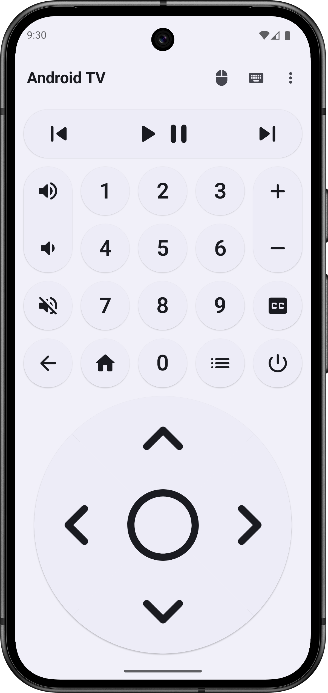
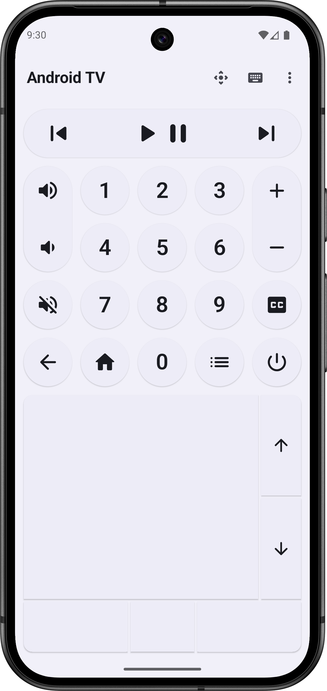
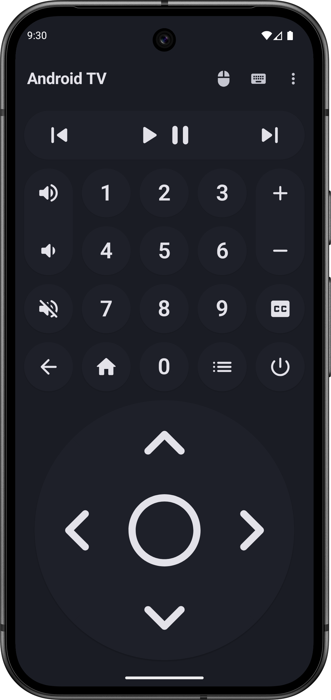
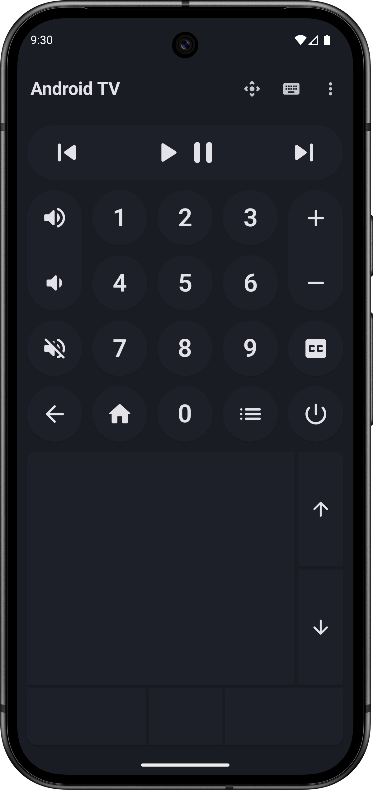
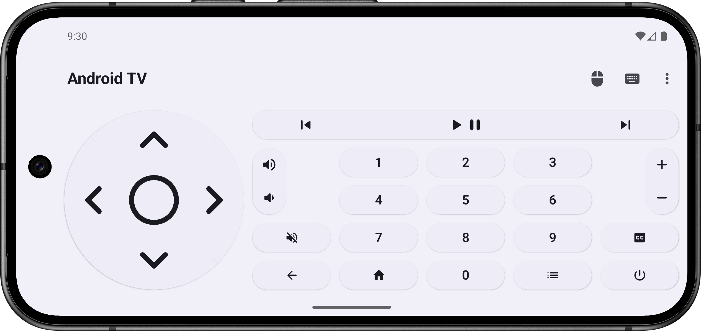
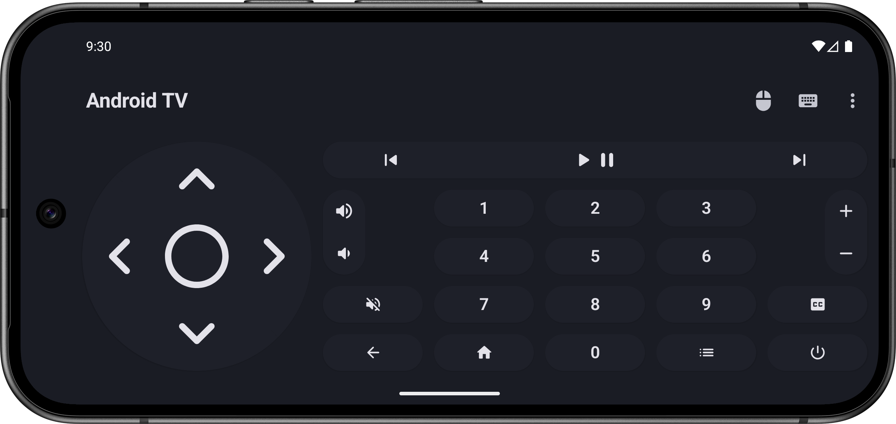

# 新增了触摸板全屏化功能，原版的触摸板太小了，更改了应用包名，其他一切不变

## We added a full-screen mode for the trackpad — the old one was way too small. Also changed the app package name. Everything else is the same.

## 
BT Remote

<h4>将您的智能手机变为蓝牙遥控器，轻松导航和操作您的Android TV设备。</h4>

<h4>An Android app that turns your smartphone into a Bluetooth remote for Android TV.</h4>

你可以直接从[github](https://github.com/conch-6/BtRemote/releases/tag/1.13.0)下载 APK 文件。

You may also download the APK directly from [github](https://github.com/conch-6/BtRemote/releases/tag/1.13.0).

  
🇨🇳 中文

    
### 将您的智能手机变为蓝牙遥控器，轻松导航和操作您的Android TV设备。

- 通过蓝牙连接进行无线控制。
- 包含遥控设备所需的所有按键。
- 支持集成的鼠标和键盘功能。
- 借助HID协议，无需在Android TV设备上安装额外应用。
- 现代化且响应式的用户界面。
- 使用Kotlin、Jetpack Compose和Material 3开发。
- 注重隐私，不收集任何数据（已禁用网络权限）。
- 无广告。
- 开源。

  
🇺🇸 English - Description

### Turn your smartphone into a Bluetooth remote control to easily navigate and interact with your Android TV.

- Wireless control via Bluetooth connection.
- Includes all necessary buttons for remote control of your device.
- Support for integrated mouse and keyboard.
- No additional app installation required on your Android TV device thanks to HID protocol.
- Modern and responsive user interface.
- Developed with Kotlin, Jetpack Compose, and Material 3.
- Privacy-focused with no data collection (internet permission disabled).
- No advertisements.
- Open source.

## Screenshots

## Contribution

If you want to translate the app, please use the [Weblate on Codeberg](https://translate.codeberg.org/projects/btremote/) or submit a merge request on GitLab.
If you have any questions regarding contributions or translations, feel free to open an issue or contact the original developer by [e-mail](mailto:atharok@duck.com).

## Licences

The code is licensed under the [GPLv3](https://www.gnu.org/licenses/gpl-3.0).

Dependencies:

- [Core KTX](https://github.com/androidx/androidx) is licensed under [Apache License 2.0](https://www.apache.org/licenses/LICENSE-2.0)
- [Activity Compose](https://github.com/androidx/androidx) is licensed under [Apache License 2.0](https://www.apache.org/licenses/LICENSE-2.0)
- [Compose BOM](https://github.com/androidx/androidx) is licensed under [Apache License 2.0](https://www.apache.org/licenses/LICENSE-2.0)
- [Compose UI](https://github.com/androidx/androidx) is licensed under [Apache License 2.0](https://www.apache.org/licenses/LICENSE-2.0)
- [Compose UI Graphics](https://github.com/androidx/androidx) is licensed under [Apache License 2.0](https://www.apache.org/licenses/LICENSE-2.0)
- [Compose Material 3](https://github.com/androidx/androidx) is licensed under [Apache License 2.0](https://www.apache.org/licenses/LICENSE-2.0)
- [Compose Material Icons Extended](https://github.com/androidx/androidx) is licensed under [Apache License 2.0](https://www.apache.org/licenses/LICENSE-2.0)
- [Lifecycle Runtime Compose](https://github.com/androidx/androidx) is licensed under [Apache License 2.0](https://www.apache.org/licenses/LICENSE-2.0)
- [Navigation Compose](https://github.com/androidx/androidx) is licensed under [Apache License 2.0](https://www.apache.org/licenses/LICENSE-2.0)
- [DataStore Preferences](https://github.com/androidx/androidx) is licensed under [Apache License 2.0](https://www.apache.org/licenses/LICENSE-2.0)
- [Koin AndroidX Compose](https://github.com/InsertKoinIO/koin) is licensed under [Apache License 2.0](https://www.apache.org/licenses/LICENSE-2.0)
- [Kotlin Serialization](https://github.com/Kotlin/kotlinx.serialization) is licensed under [Apache License 2.0](https://www.apache.org/licenses/LICENSE-2.0)
